# erd.md — FP&A Web App Entity-Relationship Diagram

Derived from `docs/2-spec/design.md` §4 ("Data to Store") and verified directly against
the 9 source workbooks in `Finance Dataset/` (re-read column-by-column for this revision,
not just taken from `docs/3-plan/data-model.md`'s summary). Only tables and columns that
actually exist in those files, or are named in design.md, are included — nothing here is
invented.

Two groups of tables, kept in one diagram since `data-model.md`'s documented join keys
(`account_key`, `territory_key`, `date`) connect them:

- **Source Finance Data** — read live from the Google Drive Excel files on each refresh.
  Per design.md: *"Not stored by this app... never copied into the app's own storage."*
  Included here because `data-model.md` documents their columns and keys explicitly, and
  the app's own tables reference `territory_key` from this group.
- **Application-Owned Data** — the 3 tables design.md's §4 says this app actually persists:
  `scenarios`, `reports`, `dataset_sync_status` — plus `datasets`, `dataset_issues`,
  `report_sections`, and `fiscal_years`, four supporting tables added through the reviewed
  proposals below (not in design.md itself, each approved individually on 2026-09-15).

`calculations_bi` (the DAX measure library) is deliberately **not** an entity here — `data-model.md`
describes it as 70 plain-text formulas, not a table with rows and columns.

## Diagram

```mermaid
erDiagram
    %% ===== Source Finance Data (read live — not stored by this app) =====

    territory {
        int territory_key PK
        string country
        string region
    }

    chart_of_accounts {
        int account_key PK
        enum report "profit_and_loss|balance_sheet|adjusting"
        string class
        int class_sorting
        string sub_class
        int sub_class_sorting
        string sub_class2
        int sub_class2_sorting
        string account
        int account_sorting
        string sub_account
    }

    calendar {
        date date PK
        int year
        string quarter
        string month
        string day
    }

    fiscal_years {
        int year PK
    }

    gl {
        int id PK
        decimal entry_no
        date date FK
        int territory_key FK
        int account_key FK
        string details
        decimal amount
    }

    budget {
        int id PK
        string entry_no
        date date FK
        int territory_key FK
        int account_key FK
        string details
        string type
        decimal amount
    }

    trial_balance {
        date date FK
        int territory_key FK
        int account_key FK
        decimal amount
    }

    currency_rate {
        date date FK
        string currency
        decimal exchange_rate
        int territory_key FK
    }

    cash_flow_mapping {
        string type
        string subtype
        string account
        string sub_account
        string value_type
        int account_key FK
        int sort_on_type
        int sort_on_sub_type
    }

    soce_mapping {
        string type
        string account
        string balance_type
        int account_key FK
        int sort_by_type
        int sort_by_account
    }

    %% ===== Application-Owned Data (persisted by this app) =====

    scenarios {
        string id PK
        string name
        int territory_key FK
        int fiscal_year FK
        decimal sales_growth
        decimal price_change
        decimal cost_of_sales_rate
        decimal opex_change
        int headcount_change
        enum scenario_type "base_case|custom"
        datetime last_saved_at
    }

    reports {
        string id PK
        enum report_type "monthly_management_pack|board_pack|territory_review|variance_memo"
        int territory_key FK "nullable — null means All Territories"
        int fiscal_year FK
        string period
        enum currency "usd|local"
        text frozen_figures
        datetime generated_at
    }

    report_sections {
        string report_id FK
        enum section_name "kpi_summary|profit_and_loss|territory_summary|ranked_variances|forecast_outlook"
    }

    datasets {
        string name PK "gl|budget|trial_balance|chart_of_accounts|currency|territory|cash_flow_mapping|soce|calendar"
    }

    dataset_sync_status {
        string dataset_name PK, FK
        int row_count
        datetime last_refreshed_at
        enum validation_status "pass|fail"
    }

    dataset_issues {
        string id PK
        string dataset_name FK
        string row_ref
        string message
    }

    %% ===== Relationships =====

    territory ||--o{ gl : "has"
    territory ||--o{ budget : "has"
    territory ||--o{ trial_balance : "has"
    territory ||--o{ currency_rate : "has"
    territory ||--o{ scenarios : "modelled for"
    territory |o--o{ reports : "scoped to (nullable — null = All Territories)"

    fiscal_years ||--o{ scenarios : "modelled for"
    fiscal_years ||--o{ reports : "scoped to"

    chart_of_accounts ||--o{ gl : "classifies"
    chart_of_accounts ||--o{ budget : "classifies"
    chart_of_accounts ||--o{ trial_balance : "classifies"
    chart_of_accounts ||--o{ cash_flow_mapping : "maps"
    chart_of_accounts ||--o{ soce_mapping : "maps"

    calendar ||--o{ gl : "dates"
    calendar ||--o{ budget : "dates"
    calendar ||--o{ trial_balance : "dates"
    calendar ||--o{ currency_rate : "dates"

    reports ||--o{ report_sections : "includes"

    datasets ||--|| dataset_sync_status : "tracks"
    datasets ||--o{ dataset_issues : "flags"
```

## Legend / decisions made while drawing this

- **Enums** are written as `enum column "value1|value2|..."` since Mermaid has no native
  enum-value syntax — the quoted comment lists the allowed values. Sources: `chart_of_accounts.report`
  and `dataset_sync_status.validation_status` (data-model.md); `scenarios.scenario_type`,
  `reports.report_type`, `reports.currency`, `report_sections.section_name` (design.md §2–3,
  §10, §11's dataset list, and design.md §4).
- **`dataset_name` is a real reference table (`datasets`), not an enum, approved 2026-09-15** —
  the fixed 9-name list used to be duplicated as an enum on both `dataset_sync_status` and
  `dataset_issues`; a real FK to one `datasets` table means adding or renaming a dataset only
  happens in one place, and the two other tables can't silently drift out of sync with it.
- **No primary key is marked** on `trial_balance` or `currency_rate` — neither `design.md` nor
  `data-model.md` documents one, and there's no natural candidate either. Marking one would
  overstate what's documented.
- **`gl.id` and `budget.id` are surrogate keys, approved 2026-09-15** — `entry_no` is confirmed
  non-unique (repeats by design across territories, plus 24 real duplicate rows found within one
  territory in Phase 0 testing), so neither table had anything that could reliably identify one
  exact row. Since these tables are read-only and re-derived on every refresh from source Excel
  files with no such column, the `id` must be assigned consistently at read-time on each refresh
  to stay meaningful — worth keeping in mind when this is actually implemented.
- **`scenarios.id` and `reports.id` are surrogate keys, approved 2026-09-15** — design.md documents
  no natural identifier for either, and both need one: `name + territory_key + fiscal_year` isn't
  unique once "Save as new" lets someone duplicate a scenario, and Reports' "Regenerate" needs
  something stable to point at. Unlike the source-data tables above, this was a deliberate addition
  (not something already in design.md), reviewed and approved separately — see the improvements
  table below for the remaining, still-unapproved proposals.
- **`reports.territory_key` is nullable, approved 2026-09-15** — Reports can be scoped to "All
  territories" (design.md screen 10), which isn't a row in `territory`. `NULL` now explicitly means
  "All territories" rather than being an undefined edge case; the relationship is drawn `|o--o{`
  (zero-or-one territory per report) instead of `||--o{` (exactly one) to match.
- **`budget.type`** is plain `string`, not `enum`, even though it only ever holds `"B"` —
  `data-model.md` explicitly calls it "not a useful discriminator," so treating it as a real enum
  would overstate its meaning.
- **`gl.entry_no` is `decimal` (e.g. `1.1`, `1.2`), while `budget.entry_no` is `string` (e.g. `"B1"`)** —
  confirmed by reading both files directly; they are genuinely different types in the source data,
  not just a formatting difference, so the diagram doesn't force them to match.
- **The territory/account join-key column is spelled three different ways across the raw files** —
  `Territory_key` in most files, `Territory _key` (stray space) in `Currency_data.xlsx`; `Account_key`
  in most files, `Account_Key` (capital K) in `CashFlow_St.xlsx`, and `AccountKey` (no underscore) in
  `SoCE.xlsx`. The diagram normalizes all three to `territory_key`/`account_key` for readability — a
  real ETL/import layer would need to handle this inconsistency explicitly, since it won't auto-align.
- `CashFlow_St.xlsx` has 3 trailing columns with no header or no data at all (two blank headers and one
  literally named `Column3`, all-`None` down every row) — confirmed empty and excluded from `cash_flow_mapping`.
- **`dataset_sync_status.flagged_issues` was split into its own `dataset_issues` table, approved
  2026-09-15** — the Data Library screen names issues "row by row," which a flat string can't
  represent cleanly.
- **`reports.sections_included` was split into its own `report_sections` junction table, approved
  2026-09-15** — for the same reason: a flat string can't be queried across reports (e.g. "which
  reports included Forecast Outlook"), only parsed.
- **`scenarios.fiscal_year` and `reports.fiscal_year` are FKs to a new `fiscal_years` table,
  approved 2026-09-15** — previously a bare, unchecked integer on both tables, meaning nothing
  stopped saving a Scenario or Report against a fiscal year that doesn't exist in the calendar
  data. `fiscal_years.year` is the distinct set of years already present in `calendar`.

## Suggested Improvements — Review Log

All 7 proposals from the original review have now been decided (2026-09-15) and applied directly
to the diagram above — none are pending.

| # | Suggestion | Decision |
|---|---|---|
| 1 | Surrogate `id` PK on `scenarios` and `reports` | ✅ Approved — applied |
| 2 | Make `reports.territory_key` nullable (`null` = All Territories) | ✅ Approved — applied |
| 3 | Split `dataset_sync_status.flagged_issues` into a `dataset_issues` child table | ✅ Approved — applied |
| 4 | Split `reports.sections_included` into a `report_sections` junction table | ✅ Approved — applied |
| 5 | Surrogate `id` PK on `gl` and `budget` | ✅ Approved — applied |
| 6 | Replace the `dataset_name` enum with a real `datasets` reference table | ✅ Approved — applied |
| 7 | FK `scenarios`/`reports.fiscal_year` → a new `fiscal_years` table | ✅ Approved — applied |

Nothing further is queued. Raise a new proposal here the same way if another gap turns up later.
