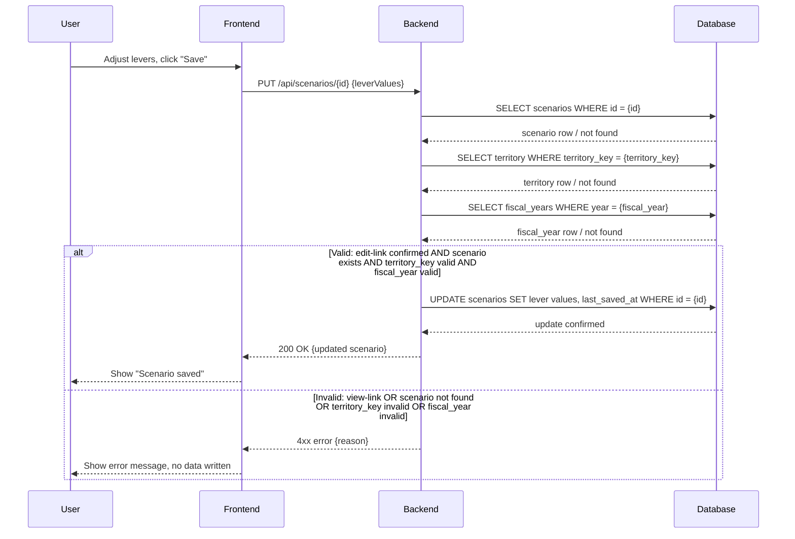
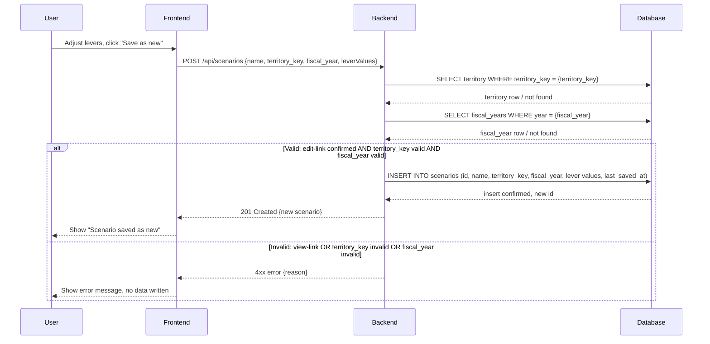
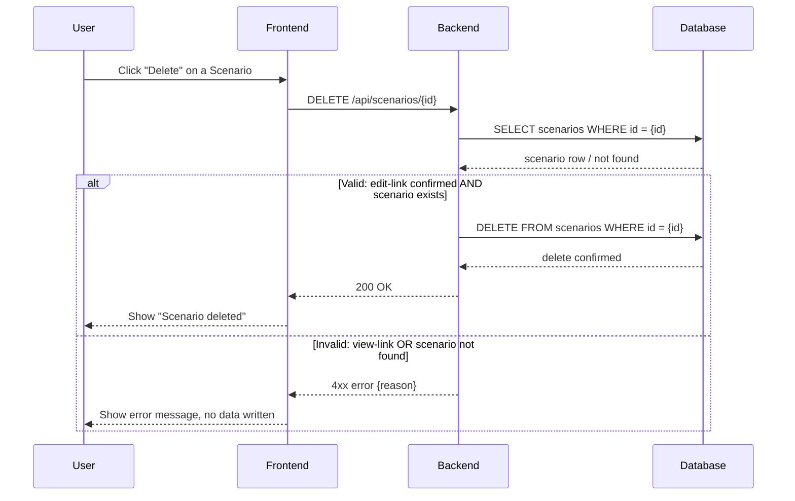
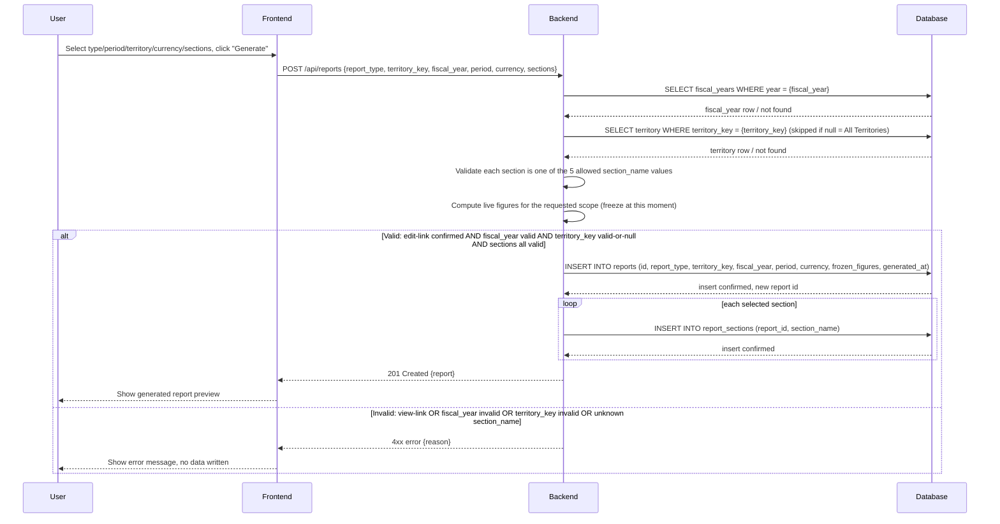
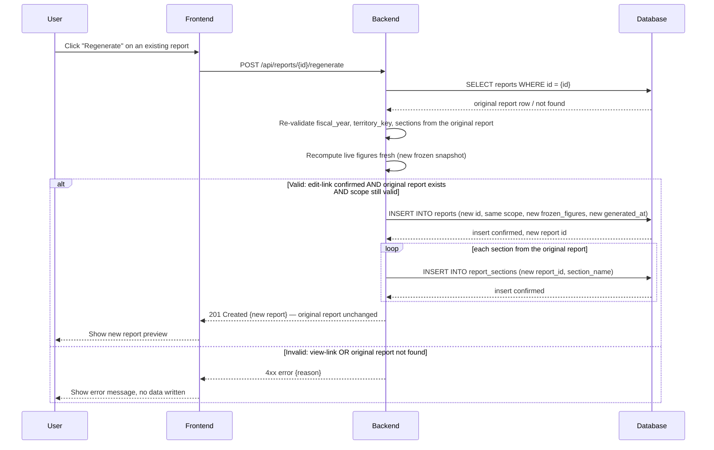
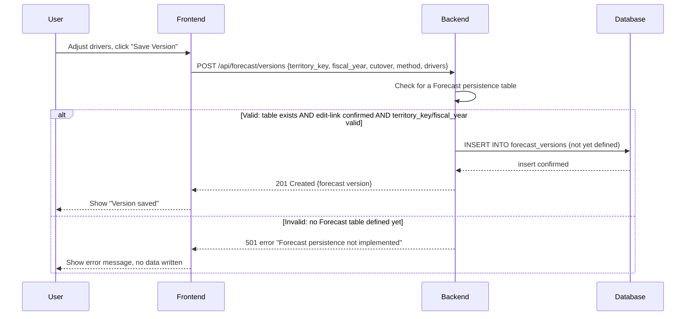
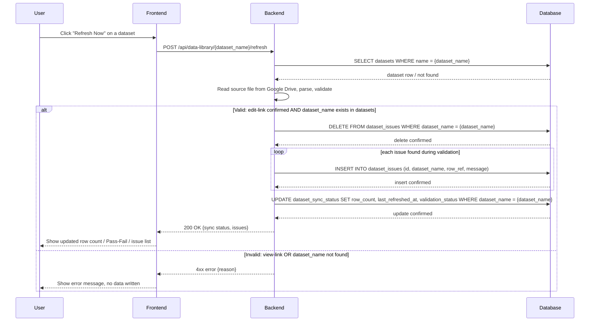
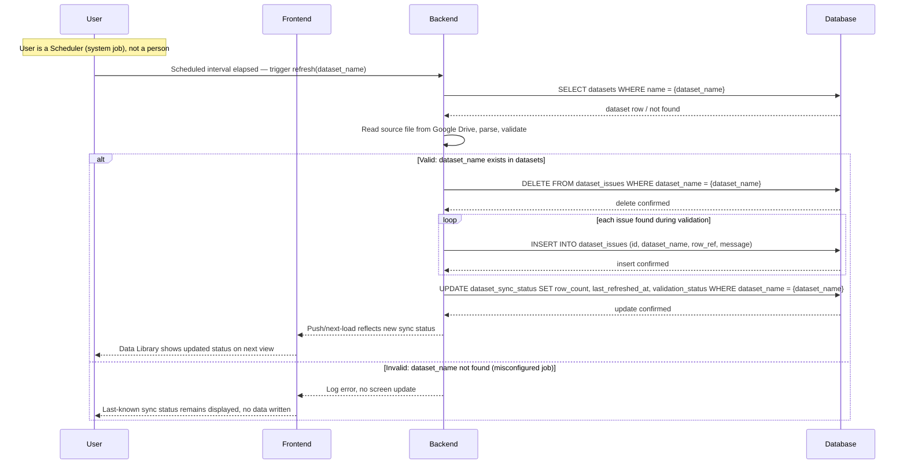
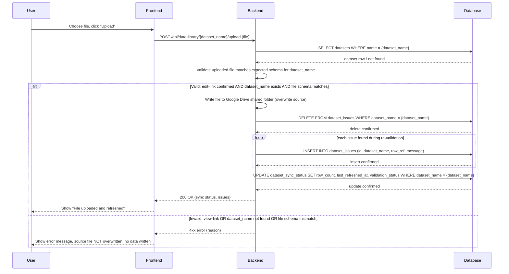
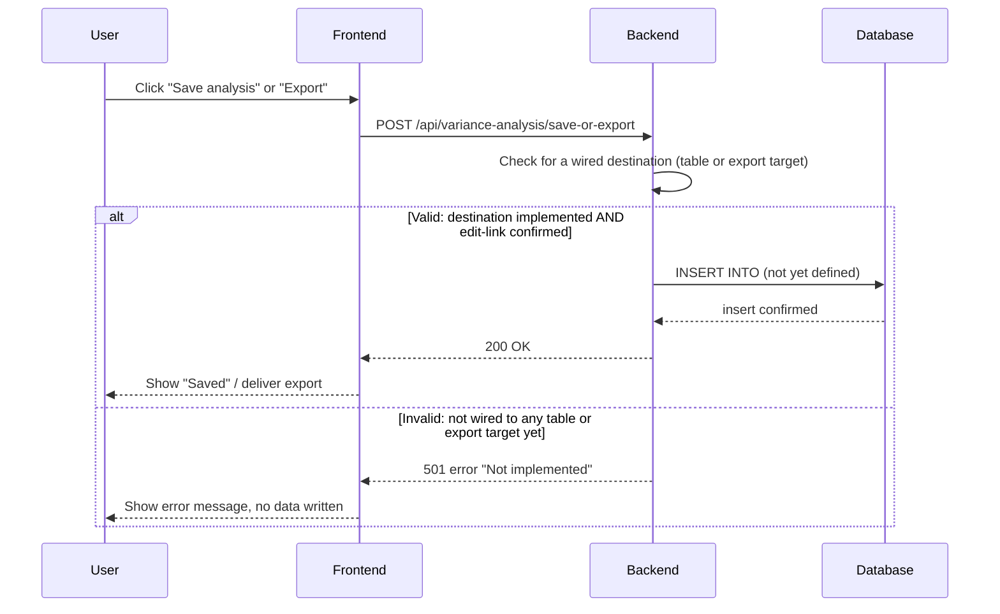

# sequence.md — FP&A Web App Sequence Diagrams

## 1. Save changes to an existing Scenario

## 2. Save as new Scenario

## 3. Delete a Scenario

## 4. Generate a Report

## 5. Regenerate a Report

## 6. Save a Forecast Version

## 7. Trigger manual "Refresh Now" (Data Library)

## 8. Scheduled automatic refresh

## 9. Upload a new source file (Data Library)

## 10. "Save analysis" / "Export" (Variance Analysis)

